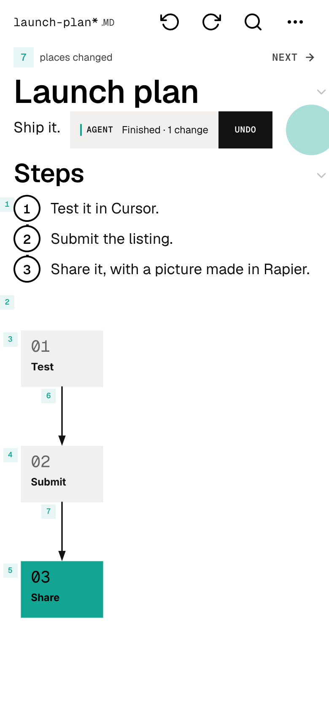
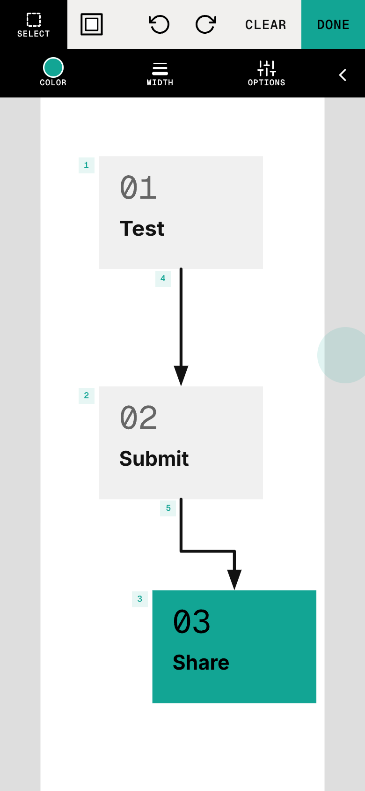
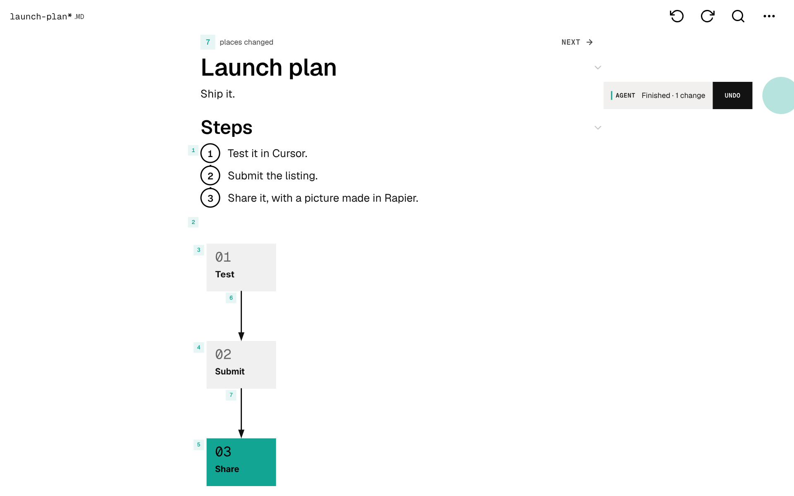

# Rapier - Markdown Editor & Art: Cursor plugin

Rapier is a Markdown editor with art built in. With this plugin your agent writes and revises a document with you on
one page you both edit, draws diagrams whose boxes you move by hand, and paints watercolors that spread, mix and dry.
Keep the result as Markdown, or as one offline HTML file that is the whole editor with your document inside.

Version 1.2.40. MCP server: `https://mcp.rapier.website/door/mcp`. No Rapier account, key or sign-in is needed.

## Write together

Ask: "Create a project plan in Rapier with a diagram whose boxes I can move."

The agent opens a document and gives you its link. Open it, and you both edit the same page. The agent reads the exact
passage before each edit, so it never writes over your typing, and each change it makes is marked. Drag a box in the
diagram or rewrite a line, and the agent reads your change back. Say "Undo that" to reverse the agent's change while
keeping yours. Then: "Give me this as one offline HTML file I can keep editing."

<picture><source media="(prefers-color-scheme: dark)" srcset="assets/write-390-dark.png"></picture> <picture><source media="(prefers-color-scheme: dark)" srcset="assets/diagram-390-dark.png"></picture>

<picture><source media="(prefers-color-scheme: dark)" srcset="assets/write-1280-dark.png"></picture>

## Paint together

Ask: "Paint a small watercolor sunset over the sea in Rapier and leave room for me to add a boat."

Keep the editor link open while it paints: painting runs in your open editor, and watercolor needs WebGPU. The
painting is finished when the agent reports it committed; then pick up the brush yourself. Without WebGPU the agent
offers regular brushes or an editable diagram.

Every picture here was made in Rapier: the agent's words and diagram, and the person's moves in Draw.

## What it includes

| Component | Purpose |
|---|---|
| MCP server `rapier` | Six tools: `open`, `read`, `edit`, `undo`, `show`, `export` |
| Rule `rapier.mdc` | When to reach for Rapier, and the short workflow |
| Skill `rapier-agent-door` | Work together live: documents, Notes, diagrams, drawing, painting, Water, pairing |
| Skill `rapier-html` | An editable offline HTML file, or a page that shows a deliberate comparison |
| Skill `rapier-markdown` | Portable Markdown that keeps pictures, drawings and layout in one `.md` file |
| Skill `embed-rapier` | Put the Rapier reader or editor inside your own site or app |

## Install

From the marketplace: open **Cursor Settings → Plugins**, search for **Rapier** and choose **Install**.

To test a local copy, copy this folder into Cursor's local plugin directory, then run **Developer: Reload Window**:

```sh
mkdir -p ~/.cursor/plugins/local/rapier
cp -R cursor/. ~/.cursor/plugins/local/rapier/
```

Local plugin imports must be enabled. Copy the files: Cursor skips symlinks to a folder outside its local plugin
directory. An installed marketplace copy with the same name takes precedence. Nothing needs configuring.

## Try it

- "Write my blog post in Rapier with the images embedded so I can keep editing it, then export it as HTML."
- "Make a Mermaid diagram of how our company's data flows, put our report underneath for me to check, then give me a PDF to print for the meeting."
- "Make my document more concise and better structured, and show me each change so I can compare it and undo any one of them."
- "Draw a flowchart of our new plan with boxes I can move around."
- "Paint the first layer of a watercolor garden, then we'll take turns."
- "Turn this Markdown report into a Rapier HTML file my friend can read and edit offline, with no Markdown app installed."

## Requirements and limits

- Live work needs an internet connection and a browser; downloaded files stay editable offline.
- Painting needs the editor open. Water needs WebGPU; without it the agent offers regular
  brushes or an editable diagram.
- Notes use the store you configured on your own device. The hosted workspace cannot read encrypted Notes and
  reports them as locked or unavailable, not empty. Sync runs only when you ask and can replace files.
- Word, PDF and rendered-page exports need an available editor or renderer. Hosted workspaces expire after 30 idle days; export links last
  up to 24 hours. Download your work to keep it.
- The rapier-html and rapier-markdown skills' local helpers need Node and npm; with the MCP server alone, the agent
  exports the file instead.

## Pair another browser

If the editor link shows a four-letter code, tell the agent the code within a minute. It calls `show` with
`target: "pair"` and the code; then press **Allow** in that browser. Each code works once.

## Other hosts

In a host that accepts a custom MCP server, add one named rapier at
https://mcp.rapier.website/door/mcp. A custom server supplies the six tools and the server's instructions, not these skills or
the rule. Other Agent Plugins clients use the repository root's `plugin.json`, `mcp.json` and `skills/`.
Install one Rapier package in each client.

## Troubleshooting

- Rapier tools missing: check **Customize** lists the `rapier` MCP server and that it is enabled, then start a new chat.
- `editor_not_present`: open the editor link and keep it visible; to pair a browser, use its code as above.
- `OPEN_ARGUMENTS_CONFLICT` on `open` with `title`: name ordinary documents with `filename`; `title` is for a new Note.

## Privacy, terms and support

The agent sends only the document you share to the hosted workspace. Rapier reaches only that document or the Notes
store you connect; it cannot search other files on your computer, send email or make purchases. No analytics or
advertising.
Read [Privacy and terms](PRIVACY.md) (also at https://rapier.website/privacy). License: AGPL-3.0-only.
Questions and problems: https://github.com/jackskip22/rapier-plugins/issues or hello@rapier.website. More for agents: [agent guide](https://rapier.website/agents).
