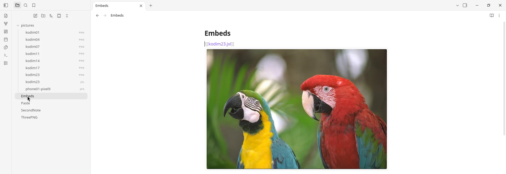
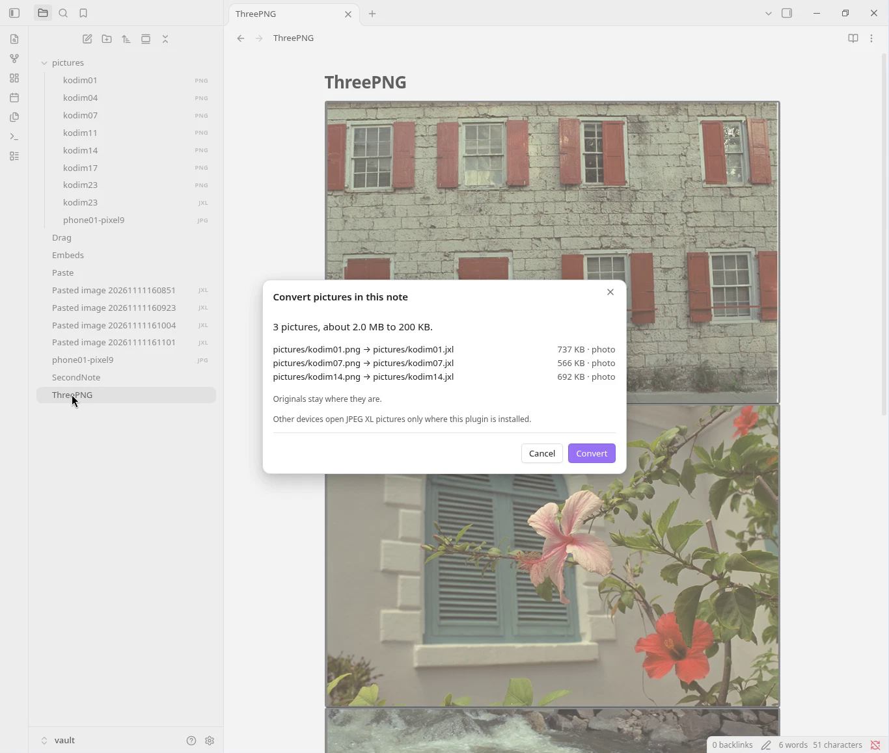
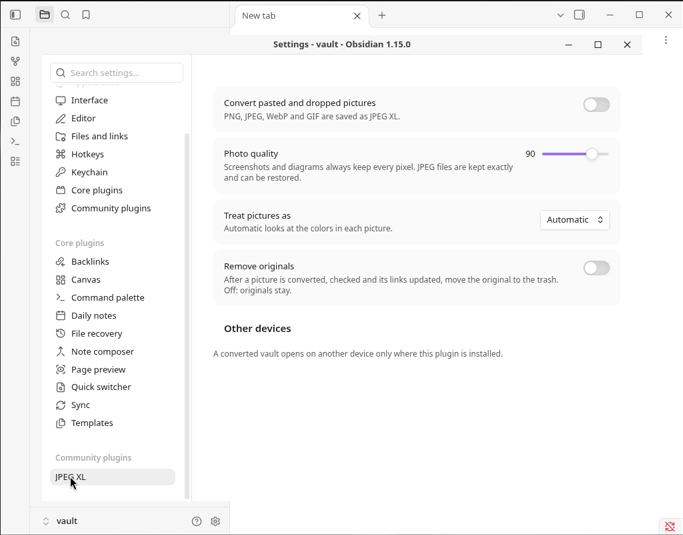

# JPEG XL for Obsidian

Open `.jxl` pictures in your notes, and convert PNG, JPEG, WebP and GIF files to smaller JPEG XL files, as you paste or across the vault.

## Install

Settings, Community plugins, Browse, search for "JPEG XL", Install, Enable.

## What it saves

One file each, converted by this plugin at its defaults (photo quality 90). WebP made with Pillow 12.3: lossless for screenshots and the animation, quality 90 for photographs. Not an average.

| Picture | Original | WebP | JPEG XL |
|---|---|---|---|
| Screenshot of a note, 2200 × 1520 PNG | 192 KB | 56 KB | **36 KB**, every pixel kept |
| Screenshot of code, 1960 × 840 PNG | 175 KB | 57 KB | **39 KB**, every pixel kept |
| Phone photo pasted as a 2560 × 1920 PNG | 7.63 MB | 893 KB | **789 KB**, quality 90 |
| Phone photo, 12.5 MP JPEG | 5.44 MB | 1.83 MB, re-encoded with loss | **4.85 MB**, the JPEG restores exactly |
| Animated GIF, 24 frames, 360 × 160 | 77 KB | 66 KB | **37 KB**, every pixel kept |

A picture is replaced only if the new file is smaller.

## Your files

- Everything runs on your device. No network, no telemetry; no file leaves your vault.
- Nothing is overwritten. Each new picture is read back and checked against the original before any link changes. Originals stay unless you turn on **Remove originals**, and then they go to Obsidian's trash.
- **Undo the last conversion** puts the links back.
- A converted vault opens on another device only where this plugin is installed.

## Commands

Convert this picture · Convert all pictures in this note · Convert all pictures in the vault · Convert this picture back to PNG · Restore the original JPEG · Undo the last conversion

Made with [rapier-jxl](https://github.com/jackskip22/rapier-jxl). MIT license.
